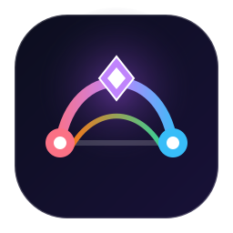
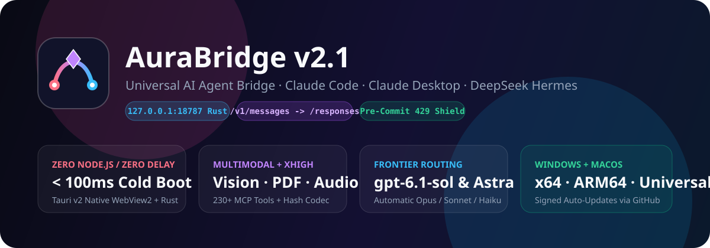
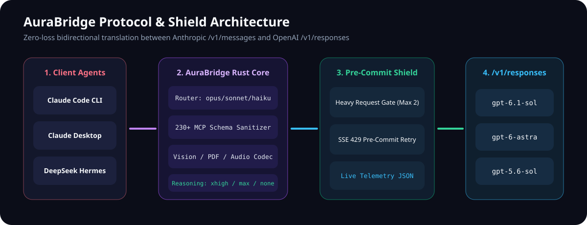
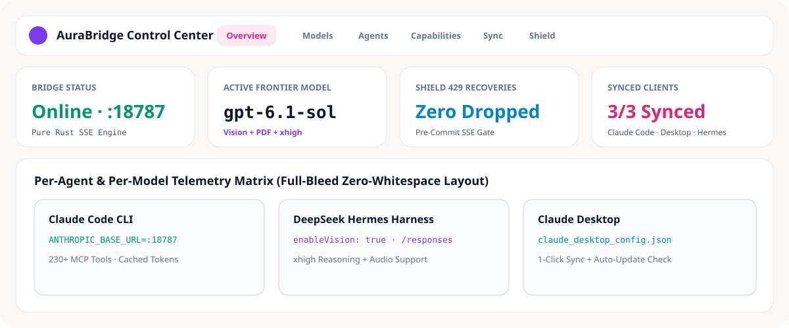
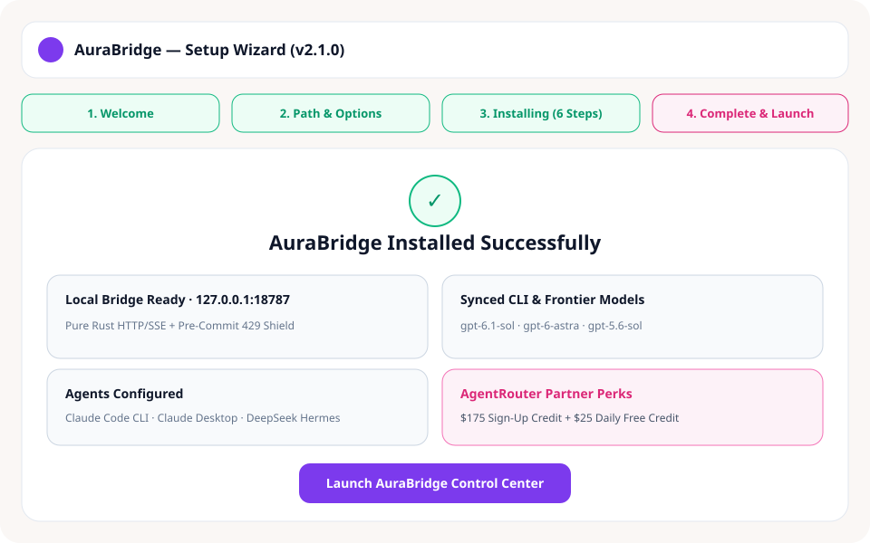
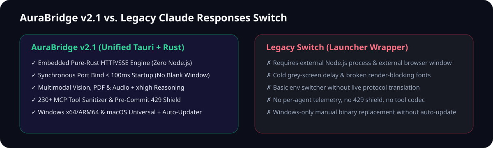

<div align="center" dir="rtl">



# AuraBridge

**جسر بروتوكول `/v1/responses` الشامل لوكلاء الذكاء الاصطناعي ومركز التحكم ومعالج التثبيت**

[English (الأصل)](README.md) · [العربية](README.ar.md) · [التنزيلات](https://github.com/Mstrq4/aura-bridge/releases/latest) · [خارطة الطريق](ROADMAP.md) · [المساهمة](CONTRIBUTING.md)

[](https://github.com/Mstrq4/aura-bridge/actions/workflows/ci.yml)
[](https://github.com/Mstrq4/aura-bridge/actions/workflows/release.yml)
[](LICENSE)



### رصيد مجاني للبدء على المنصة السحابية
للحصول على وصول فوري إلى النماذج المتقدمة (`gpt-6.1-sol`، `gpt-6-astra`، `gpt-5.6-sol`) عبر `/v1/responses`:

[**سجّل في AgentRouter الآن — واحصل على $175 رصيداً مجانياً عند التسجيل + $25 رصيداً مجانياً كل يوم**](https://agentrouter.org/register?aff=lohG)

> **شرط مهم لضمان استلام الرصيد**: يجب أن يكون عمر حساب **GitHub** المستخدم في التسجيل على منصة AgentRouter **أكثر من أسبوعين (14 يوماً على الأقل)** لضمان تفعيل الرصيد الترحيبي ($175) والرصيد اليومي ($25).

</div>

---

<div dir="rtl">

## التنزيل المباشر لجميع الأنظمة والمعماريات

| النظام | المعمارية | النوع | رابط التحميل |
| :--- | :--- | :--- | :--- |
| **ويندوز (Windows)** | `x86_64` (64-بت) | معالج التثبيت البصري Aura (4 مراحل) | [**تحميل `AuraBridge-Setup-windows-x86_64.exe`**](https://github.com/Mstrq4/aura-bridge/releases/latest/download/AuraBridge-Setup-windows-x86_64.exe) |
| **ويندوز (Windows)** | `x86_64` (64-بت) | نسخة محمولة بدون تثبيت | [**تحميل `AuraBridge-windows-x86_64-portable.exe`**](https://github.com/Mstrq4/aura-bridge/releases/latest/download/AuraBridge-windows-x86_64-portable.exe) |
| **ويندوز (Windows)** | `x86` (`i686` 32-بت) | معالج التثبيت البصري (32-بت) | [**تحميل `AuraBridge-Setup-windows-x86.exe`**](https://github.com/Mstrq4/aura-bridge/releases/latest/download/AuraBridge-Setup-windows-x86.exe) |
| **ويندوز (Windows)** | `ARM64` (`aarch64`) | معالج التثبيت البصري ARM64 | [**تحميل `AuraBridge-Setup-windows-arm64.exe`**](https://github.com/Mstrq4/aura-bridge/releases/latest/download/AuraBridge-Setup-windows-arm64.exe) |
| **ماك (macOS)** | Apple Silicon (`M1–M4`) | حزمة `.dmg` موقّعة | [**تحميل `AuraBridge_2.1.0_aarch64.dmg`**](https://github.com/Mstrq4/aura-bridge/releases/latest/download/AuraBridge_2.1.0_aarch64.dmg) |
| **ماك (macOS)** | Intel (`x86_64`) | حزمة `.dmg` موقّعة | [**تحميل `AuraBridge_2.1.0_x64.dmg`**](https://github.com/Mstrq4/aura-bridge/releases/latest/download/AuraBridge_2.1.0_x64.dmg) |
| **ماك (macOS)** | الحزمة الشاملة (`Universal`) | ملف `.dmg` موحّد (Silicon + Intel) | [**تحميل `AuraBridge_2.1.0_universal.dmg`**](https://github.com/Mstrq4/aura-bridge/releases/latest/download/AuraBridge_2.1.0_universal.dmg) |
| **لينكس (Linux)** | `x86_64` (`amd64`) | `.AppImage` / `.deb` / `.rpm` / محمول | [**تنزيل Linux x64 من GitHub Releases**](https://github.com/Mstrq4/aura-bridge/releases/latest) |
| **لينكس (Linux)** | `ARM64` (`aarch64`) | `.AppImage` / `.deb` / `.rpm` / محمول | [**تنزيل Linux ARM64 من GitHub Releases**](https://github.com/Mstrq4/aura-bridge/releases/latest) |

> لدعم التثبيت الصامت الآلي في بيئات العمل:
> ```powershell
> .\AuraBridge-Setup-windows-x86_64.exe --silent
> ```

---

## لماذا تم بناء AuraBridge؟ (القصة الكاملة للمشكلة والحل)

عند ربط أدوات البرمجة بالذكاء الاصطناعي مثل **Claude Code CLI** و**Claude Desktop** و**DeepSeek Hermes** مع نماذج الاستدلال الحديثة (`gpt-6.1-sol`، `gpt-6-astra`، `gpt-5.6-sol`) على منصات مثل `agentrouter.org`، ظهرت 4 مشكلات جوهرية متكررة:

1. **رفض استدعاء الأدوات مع مستوى التفكير في `/v1/chat/completions` (`Error 400`)**:
   ```text
   API Error: 400 Function tools with reasoning_effort are not supported for gpt-5.6-sol in /v1/chat/completions.
   To use function tools, use /v1/responses or set reasoning_effort to 'none'.
   ```
   الوكلاء البرمجيون يحتاجون استدعاء عشرات الأدوات (`Function Tools`) والتفكير العميق (`reasoning_effort`) معاً في آن واحد، وبروتوكول `/v1/chat/completions` لا يدعم الجمع بينهما في هذه النماذج.

2. **أخطاء الصلاحيات وتوجيه الفئات (`HTTP 403`)**:
   ```text
   Failed to authenticate. API Error: 403 该令牌无权访问模型 gpt-6.1-sol
   ```
   لذلك صُمّم موجّه ذكي يربط أسماء Claude (`opus`/`sonnet`/`haiku`) بدقة بالنماذج المتاحة لكل مستخدم دون تعديل يدوي متكرر.

3. **فقدان دعم الصور وPDF والصوت وتجاوز حد أسماء أدوات MCP**:
   تمت معالجة أكثر من 230 أداة MCP عبر معقّم مخططات JSON متكامل مع ترميز حتمي لأسماء الأدوات الأطول من 64 حرفاً، ودعم كامل للصور (`Vision`) وملفات `PDF` وحزم الصوت ومستويات التفكير حتى `xhigh`/`max`.

4. **أخطاء الضغط `429` وبطء الفتح في البرامج القديمة**:
   تم بناء **درع الحماية الاستباقي قبل الالتزام بالبث (`Pre-Commit SSE Shield`)** لالتقاط وإعادة محاولة أخطاء `429` دون انقطاع الجلسة، مع استبدال تشغيل Node.js والمتصفح الخارجي بنواة **Tauri v2 + Rust** تفتح خلال أقل من 100ms دون شاشة رمادية فارغة.

<div align="center">
  
</div>

---

## واجهة التحكم ومعالج التثبيت

<div align="center">
  
</div>

<div align="center">
  
</div>

---

## ما الذي تفوّق به AuraBridge على برنامج `Switch` السابق؟

<div align="center">
  
</div>

* **محرك بروتوكول مدمج بـ Rust**: لا يحتاج Node.js ويترجم `/v1/messages` ↔ `/v1/responses` لحظياً، على عكس برنامج `Switch` الذي كان يكتفي بتبديل متغيرات البيئة فقط.
* **إقلاع فوري بدون تأخير**: ربط المنفذ `18787` قبل إظهار النافذة مع خطوط نظام محلية سريعة.
* **دعم الوسائط المتعددة والتفكير المتدرج**: صور + ملفات PDF + الصوت + التفكير `xhigh` + معالجة +230 أداة MCP.
* **تحليلات تفصيلية لكل وكيل**: لوحة قياس مستقلة لاستهلاك `Claude Code` و`DeepSeek Hermes` و`Claude Desktop` ونسبة توفير الكاش.
* **معالج تثبيت مرئي وتحديث تلقائي عبر GitHub**: دعم كامل لنظامي Windows (`x64`/`ARM64`) وmacOS (`Apple Silicon`/`Intel`/`Universal`) مع تحديث موقّع.

---

## دليل الإعداد السريع

1. نزّل وشغّل معالج التثبيت **`AuraBridge-Setup-windows-x86_64.exe`** (أو ملف `.dmg` على الماك).
2. أنشئ حسابك للحصول على مفتاح API عبر [**AgentRouter ($175 رصيد ترحيبي + $25 يومياً)**](https://agentrouter.org/register?aff=lohG).
3. من تبويب **المزود والنماذج** داخل التطبيق، أدخل مفتاح `sk-...` ثم اضغط **حفظ وتطبيق**.
4. اضغط **مزامنة وتطبيق** في تبويب **التطبيقات المرتبطة** لتهيئة `Claude Code` و`Claude Desktop` و`DeepSeek Hermes` فوراً.

للاطلاع على خارطة التطوير الموسّعة راجع [ROADMAP.md](ROADMAP.md)، وللمساهمة في التطوير راجع [CONTRIBUTING.md](CONTRIBUTING.md).

</div>

