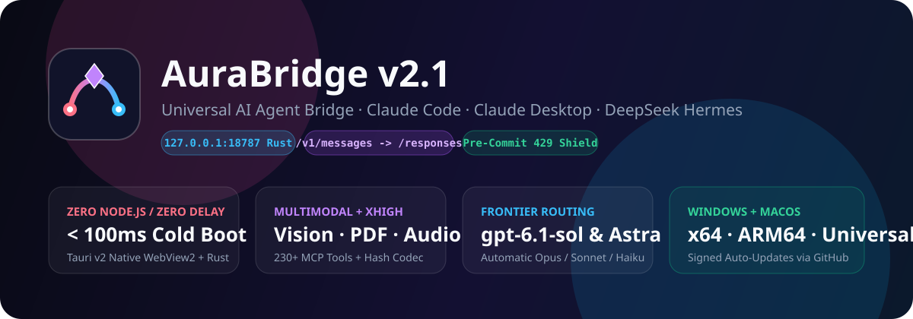
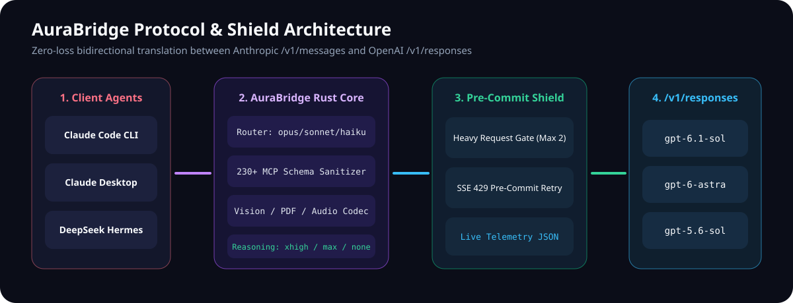
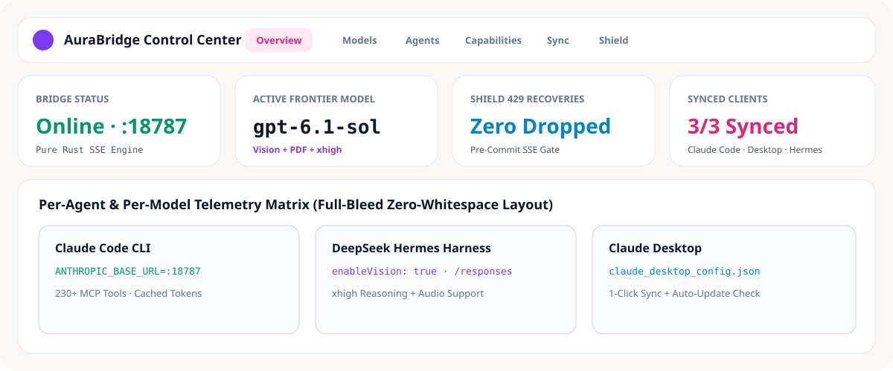
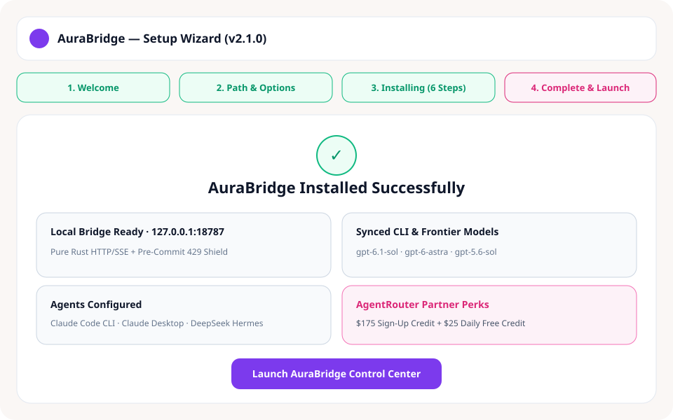
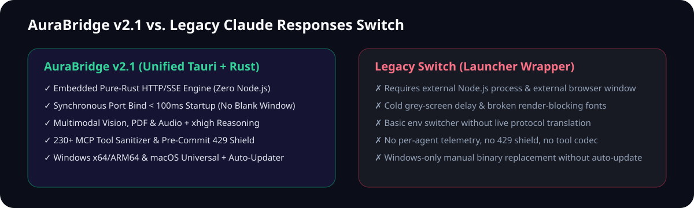

<div align="center">


# AuraBridge

**Universal AI Agent `/v1/responses` Bridge, Control Center & Setup Wizard**

[English](README.md) · [العربية](README.ar.md) · [Releases](https://github.com/Mstrq4/aura-bridge/releases/latest) · [Roadmap](ROADMAP.md) · [Contribute](CONTRIBUTING.md)

[](https://github.com/Mstrq4/aura-bridge/actions/workflows/ci.yml)
[](https://github.com/Mstrq4/aura-bridge/actions/workflows/release.yml)
[](LICENSE)



### Cloud Model Access Perks
Need ready-to-use frontier endpoints (`gpt-6.1-sol`, `gpt-6-astra`, `gpt-5.6-sol`) with full `/v1/responses` support?

[**Register on AgentRouter — Receive $175 Welcome Credit + $25 Daily Free Credit**](https://agentrouter.org/register?aff=lohG)

> **Eligibility Note**: Your **GitHub account used to sign in on AgentRouter must be older than 2 weeks (14+ days)** to guarantee unlocking the **$175 signup balance + $25 daily credit**.

</div>

---

## Direct Multi-Architecture Downloads

Download the latest signed desktop installers, packages, and portable builds directly from [GitHub Releases](https://github.com/Mstrq4/aura-bridge/releases/latest):

| Platform | Architecture | Package | Download |
| :--- | :--- | :--- | :--- |
| **Windows** | `x86_64` (64-bit) | Visual 4-Step Setup Wizard | [**Download `AuraBridge-Setup-windows-x86_64.exe`**](https://github.com/Mstrq4/aura-bridge/releases/latest/download/AuraBridge-Setup-windows-x86_64.exe) |
| **Windows** | `x86_64` (64-bit) | Portable Executable | [**Download `AuraBridge-windows-x86_64-portable.exe`**](https://github.com/Mstrq4/aura-bridge/releases/latest/download/AuraBridge-windows-x86_64-portable.exe) |
| **Windows** | `x86` (`i686` 32-bit) | Visual Setup Wizard & Portable | [**Download `AuraBridge-Setup-windows-x86.exe`**](https://github.com/Mstrq4/aura-bridge/releases/latest/download/AuraBridge-Setup-windows-x86.exe) |
| **Windows** | `ARM64` (`aarch64`) | Visual Setup Wizard (ARM64) | [**Download `AuraBridge-Setup-windows-arm64.exe`**](https://github.com/Mstrq4/aura-bridge/releases/latest/download/AuraBridge-Setup-windows-arm64.exe) |
| **macOS** | Apple Silicon (`M1–M4` / `aarch64`) | Signed `.dmg` Bundle | [**Download `AuraBridge_2.1.0_aarch64.dmg`**](https://github.com/Mstrq4/aura-bridge/releases/latest/download/AuraBridge_2.1.0_aarch64.dmg) |
| **macOS** | Intel (`x86_64`) | Signed `.dmg` Bundle | [**Download `AuraBridge_2.1.0_x64.dmg`**](https://github.com/Mstrq4/aura-bridge/releases/latest/download/AuraBridge_2.1.0_x64.dmg) |
| **macOS** | Universal (`Silicon + Intel`) | Signed Universal `.dmg` | [**Download `AuraBridge_2.1.0_universal.dmg`**](https://github.com/Mstrq4/aura-bridge/releases/latest/download/AuraBridge_2.1.0_universal.dmg) |
| **Linux** | `x86_64` (`amd64`) | `.AppImage` / `.deb` / `.rpm` / Portable | [**Download Linux x64 via Releases**](https://github.com/Mstrq4/aura-bridge/releases/latest) |
| **Linux** | `ARM64` (`aarch64`) | `.AppImage` / `.deb` / `.rpm` / Portable | [**Download Linux ARM64 via Releases**](https://github.com/Mstrq4/aura-bridge/releases/latest) |

> Silent automated Windows installation is also built in:
> ```powershell
> .\AuraBridge-Setup-windows-x86_64.exe --silent
> ```

---

## Why AuraBridge Was Created (The Origin Story)

When integrating **Claude Code CLI**, **Claude Desktop**, and **DeepSeek Hermes** with frontier OpenAI-protocol reasoning models (`gpt-6.1-sol`, `gpt-6-astra`, `gpt-5.6-sol`) hosted on gateways like `agentrouter.org`, standard `/v1/chat/completions` configurations hit fundamental protocol walls:

1. **Tool Calls + Reasoning Effort Rejection (`HTTP 400`)**:
   ```text
   API Error: 400 Function tools with reasoning_effort are not supported for gpt-5.6-sol in /v1/chat/completions.
   To use function tools, use /v1/responses or set reasoning_effort to 'none'.
   ```
   ```text
   API Error: 400 Function tools with reasoning_effort are not supported for gpt-6-astra in /v1/chat/completions.
   To use function tools, use /v1/responses or set reasoning_effort to 'none'.
   ```
   Coding agents like Claude Code depend simultaneously on dozens of function tools **and** deep chain-of-thought reasoning. Disabling `reasoning_effort` crippled coding intelligence, while keeping it broke tool calling completely on `/v1/chat/completions`.

2. **Model Permission & Tier Routing Failures (`HTTP 403`)**:
   ```text
   Failed to authenticate. API Error: 403 该令牌无权访问模型 gpt-6.1-sol
   ```
   Token tier restrictions and Anthropic alias mismatches (`claude-opus-*`, `claude-sonnet-*`, `claude-haiku-*`) required deterministic routing tables, custom headers, and instant tier overrides without manually editing `.claude/settings.json` per session.

3. **Broken Multimodal Input (Images, Screenshots, PDFs & Audio) & MCP Schema Overflow**:
   Passing 200+ MCP tools, `>64`-character function names, strict JSON Schema quirks (`additionalProperties`, unsupported formats), or inline images/PDFs caused silent drops or schema rejections.

4. **Upstream `429 Too Many Requests` Mid-Stream & Slow Legacy Launchers**:
   Heavy agent loops triggered upstream rate limits after HTTP headers were committed, killing long-running sessions. Meanwhile, wrapping Node.js + external browser windows introduced cold grey startup delays (`>3s`) and render-blocking font fetches.

**AuraBridge** eliminates every one of these bottlenecks in a **single native Tauri v2 + pure-Rust executable (`<100ms` cold boot)**.

<div align="center">
  
</div>

---

## Visual Control Center & Setup Experience

<div align="center">
  
</div>

<div align="center">
  
</div>

---

## AuraBridge v2.1 vs. Legacy `Claude Responses Switch`

<div align="center">
  
</div>

| Feature / Capability | **AuraBridge v2.1 (Tauri v2 + Rust)** | **Legacy `Switch` App** |
| :--- | :--- | :--- |
| **Runtime Architecture** | Native Tauri v2 + embedded pure-Rust Axum server (Zero Node.js) | External Edge WebView + Node script launcher |
| **Cold Startup Speed** | `<100ms` synchronous port `18787` bind before UI reveal (Zero grey screen) | Multi-second external browser boot & render-blocking CSS fonts |
| **Protocol Engine** | Full bidirectional Anthropic `/v1/messages` <-> OpenAI `/v1/responses` | Static environment/config switcher only |
| **Function Tools + Reasoning** | Simultaneous tool calling + `none`/`low`/`medium`/`high`/`xhigh`/`max` | Not supported (400 errors on `/v1/chat/completions`) |
| **230+ MCP Tool Sanitizer** | Recursive schema normalizer + deterministic `>64-char` name codec | None |
| **Multimodal Support** | Native Vision Images, PDF Documents (`input_file`), Audio blocks (`input_audio`) | Dropped or unmapped |
| **Pre-Commit 429 Shield** | Buffers pre-SSE `429`/5xx retries before committing client HTTP stream | Requests fail mid-run |
| **Per-Agent Telemetry** | Live breakdown for Claude Code, Subagents, Claude Desktop & DeepSeek Hermes | No telemetry |
| **Multi-App Sync** | 1-click config injection for Claude Code, Desktop & DeepSeek Hermes | Claude settings only |
| **Cross-Platform & Auto-Update** | Windows (`x64`, `ARM64`) + macOS (`M-series`, `Intel`, `Universal`) + Minisign updater | Windows-only manual updates |

---

## Step-by-Step Setup Guide

### Option A: Automated Setup Wizard (Recommended)
1. Download and run **`AuraBridge-Setup-windows-x86_64.exe`** (or `.dmg` on macOS).
2. Choose install directory & preferences (Desktop shortcut, Start Menu, Launch at Startup, Auto-Sync).
3. Get your API key from [**AgentRouter ($175 Welcome + $25/day Credit)**](https://agentrouter.org/register?aff=lohG).
4. Open **Providers & Models** inside AuraBridge Studio, paste your `sk-...` key, verify:
   - **Opus Tier**: `gpt-6.1-sol`
   - **Sonnet Tier**: `gpt-6-astra`
   - **Haiku Tier**: `gpt-5.6-sol`
5. Click **Save & Apply** -> launch Claude Code, Claude Desktop, or DeepSeek Hermes!

### Option B: Manual Configuration Reference

#### 1. Claude Code CLI (`~/.claude/settings.json`)
AuraBridge configures this automatically when you click **Sync & Apply to Claude Code**:
```json
{
  "env": {
    "ANTHROPIC_BASE_URL": "http://127.0.0.1:18787",
    "ANTHROPIC_AUTH_TOKEN": "sk-your-agentrouter-key",
    "ANTHROPIC_MODEL": "gpt-6.1-sol",
    "ANTHROPIC_DEFAULT_OPUS_MODEL": "gpt-6.1-sol",
    "ANTHROPIC_DEFAULT_SONNET_MODEL": "gpt-6-astra",
    "ANTHROPIC_DEFAULT_HAIKU_MODEL": "gpt-5.6-sol",
    "CLAUDE_CODE_DISABLE_EXPERIMENTAL_BETAS": "1",
    "API_TIMEOUT_MS": "240000"
  }
}
```

#### 2. DeepSeek Hermes (`~/.deepseek-harness/config.json`)
AuraBridge injects `enableVision: true`, extended reasoning (`xhigh`), and points your endpoints seamlessly to `http://127.0.0.1:18787`.

#### 3. Environment Variables (`.env`)
Stored securely outside the repo in `%LOCALAPPDATA%\AuraBridge\.env` (Windows) or `~/Library/Application Support/AuraBridge/.env` (macOS):
```env
HOST=127.0.0.1
PORT=18787
UPSTREAM_BASE_URL=https://agentrouter.org
UPSTREAM_API_KEY=sk-your-agentrouter-key
OPUS_MODEL=gpt-6.1-sol
SONNET_MODEL=gpt-6-astra
HAIKU_MODEL=gpt-5.6-sol
DEFAULT_MODEL=gpt-6.1-sol
DEFAULT_REASONING_EFFORT=medium
REASONING_SUMMARY=auto
MAX_UPSTREAM_RETRIES=6
MAX_CONCURRENT_HEAVY_REQUESTS=2
```

---

## Building from Source & Website Development

```powershell
# 1. Run all Rust bridge & installer unit/integration tests
cargo test --workspace

# 2. Build Desktop App (Tauri v2 + Embedded Rust Bridge)
npm ci
npx tauri build --no-bundle

# 3. Build Custom Visual Setup Wizard (Windows)
$env:CSP_PAYLOAD_PATH = (Resolve-Path ".\target\release\claude-switch-pro.exe").Path
cargo build --release -p claude-switch-pro-setup

# 4. Run full Rust check
cargo clippy --workspace --all-targets
```

See [**ROADMAP.md**](ROADMAP.md) for our phased engineering plan and [**CONTRIBUTING.md**](CONTRIBUTING.md) to contribute pull requests!

---

## License

Released under the [MIT License](LICENSE). Built as open-source software by [Mstrq4](https://github.com/Mstrq4/aura-bridge).
